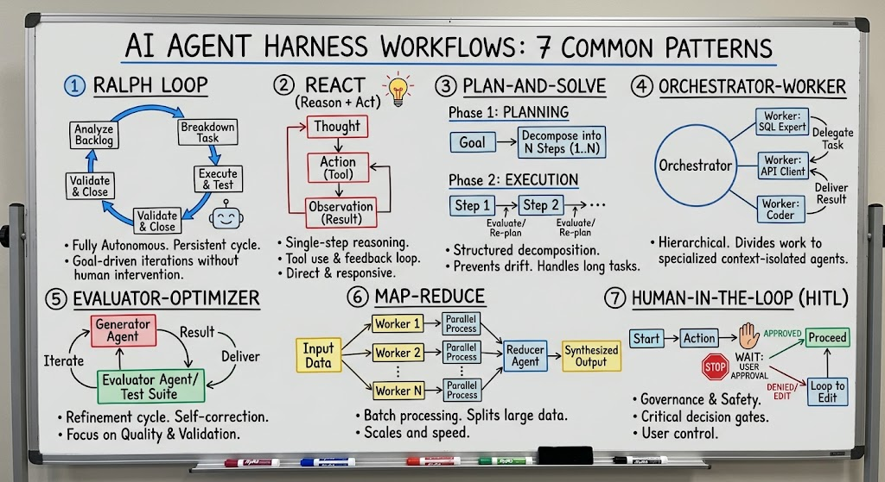

# AI Learning Path: Agents for Beginners

A curated collection of free resources about **AI agents** and **agent harnesses**: the underlying structure—loops, tools, context, and permissions—that turns a language model into an agent that can get work done.

Use this learning path to understand the key concepts, explore common agent workflows, and see how to configure an agentic coding environment.

## Contents

### 1. Videos

| # | Resource | What you'll learn |
|---|----------|-----------------|
| 1 | [Agent Harness explained](https://www.youtube.com/watch?v=Vzt4tB4ga1I) | An introduction to agent harnesses and why they matter. **Start here.** |
| 2 | [How to Build your own Agent Harness](https://www.youtube.com/watch?v=c85qiEJCGdM) | A hands-on guide to building your own harness. |

### 2. Cheat sheet: 7 common agent workflow patterns

1. **Ralph Loop**: an autonomous, persistent, goal-driven cycle with no human intervention.
2. **ReAct** (Reason + Act): reason, use a tool, and repeat based on feedback.
3. **Plan-and-Solve**: plan a sequence of steps, execute them, and reassess along the way—helpful for staying on track in long tasks.
4. **Orchestrator-Worker**: an orchestrator delegates work to specialized agents, each with isolated context.
5. **Evaluator-Optimizer**: one agent generates a result, another evaluates it, and the cycle repeats to refine and correct the output.
6. **Map-Reduce**: split large datasets across parallel workers, then combine their results.
7. **Human-in-the-Loop (HITL)**: include human approval points for governance and safety.

### 3. PDF: Claude Code in VS Code

[Claude Code in VS Code: the tricks I use every day](resources/claude_code_vscode_tricks.pdf) (31 slides, in English)

A practical tour organized into four sections:

1. **Start**: Claude tools, extension vs. CLI, and opening a project.
2. **Configure**: the `.claude/` folder, `CLAUDE.md`, skills, agents, and hooks.
3. **Orchestrate**: the Ralph Loop—documentation, plans, `progress.md`, verification, and self-correction.
4. **Amplify**: context, flags, MCP (Drive, Gmail), code review, and remote workflows.

The examples focus on coding, but the techniques also apply to reports, research, spreadsheets, Word documents, and email.
