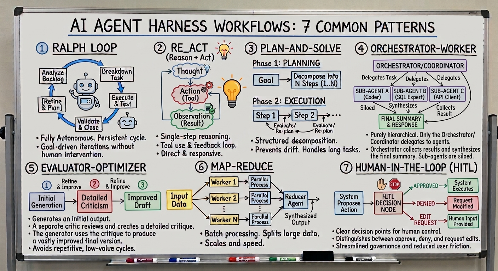

# AI Learning Path: Agents for Beginners

A curated collection of free resources about **AI agents** and **agent harnesses**: the underlying structure—loops, tools, context, and permissions—that turns a language model into an agent that can get work done.

Use this learning path to understand the key concepts, explore common agent workflows, and see how to configure an agentic coding environment.

## Why build a harness?

The idea behind a setup (or harness) is to teach Claude how to do what you do:

- Automate your tasks and make your life easier.
- Standardize behavior, rules, and quality.
- Stop writing long, repetitive prompts every time.
- Reuse stored prompts and instructions (skills, rules, etc.).

Used one session at a time, an agent is already very powerful, but every session dies on its own. When you open a new one to ask a new question, it essentially starts from scratch and knows little about you.

With a customized setup and a few learning processes, it starts to learn what *you* like, what *you* want, and how to serve your needs better. You then create a learning loop in which it refines and improves its own setup after each session. If you make an important decision in a certain way, it writes that down, and the next session is born already knowing it.

## Resources

| # | Type | Resource | What you'll learn |
|---|------|----------|-------------------|
| 1 | Video | [Agent Harness explained](https://www.youtube.com/watch?v=Vzt4tB4ga1I) | What agent harnesses are and why they matter. **Start here.** |
| 2 | Video | [How to Build your own Agent Harness](https://www.youtube.com/watch?v=c85qiEJCGdM) | A hands-on guide to building your own harness. |
| 3 | Video | [Spec, Verifier, Environment](https://www.youtube.com/watch?v=7zZy1QTvokM) | Another walkthrough on setting up your agent environment. |
| 4 | Video | [Building verification loops](https://www.youtube.com/watch?v=mQZB0l-rhxE) | How to build verification loops for your agents. |
| 5 | PDF | [Claude Code in VS Code, simplified (for complete beginners)](resources/claude_code_vscode_tricks_simplified.pdf) | **Start here for the slides.** 31 slides, VS Code extension only: first steps and folder structure, CLAUDE.md, the LLM wiki, skills (global vs local, with real examples), and the Ralph loop hands-on. The agent does the work: you describe, it builds. Editable version: [.pptx](resources/claude_code_vscode_tricks_simplified.pptx). |
| 6 | PDF | [Claude Code in VS Code, advanced](resources/claude_code_vscode_tricks_advanced.pdf) | The original 35 slides, with the CLI, terminal flags, agents, hooks, MCP and review commands. Editable version: [.pptx](resources/claude_code_vscode_tricks_advanced.pptx). |
| 7 | Article | [Grok Bot tutorial](https://x.com/0xCodez/status/2089676836619878567) | A written, step-by-step tutorial for building a Grok bot. |
| 8 | Image | [7 common agent workflow patterns](resources/harness-patterns.png) | A one-page cheat sheet of common agent workflows (Ralph Loop, ReAct, Orchestrator-Worker, and more). |

