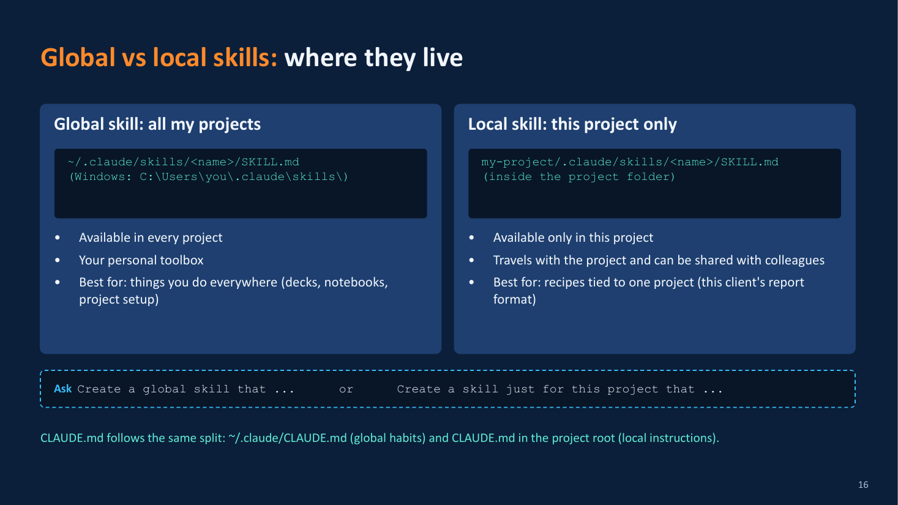
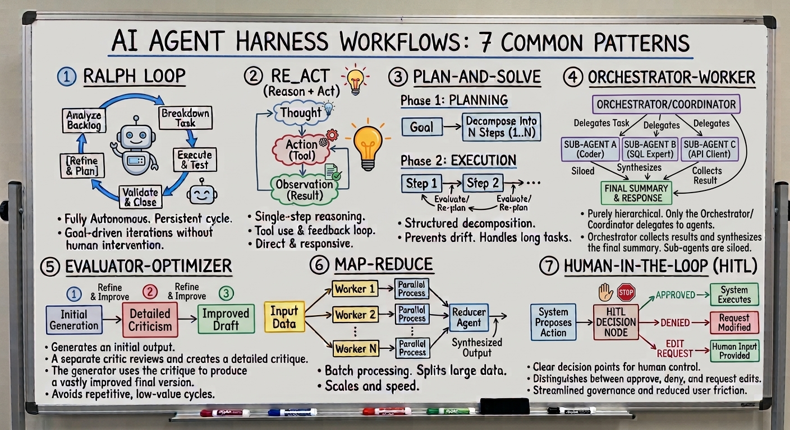
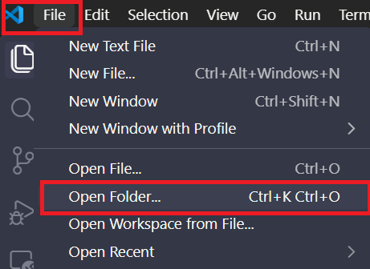
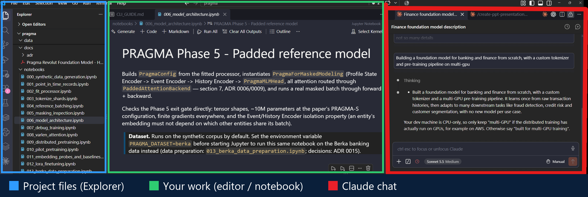
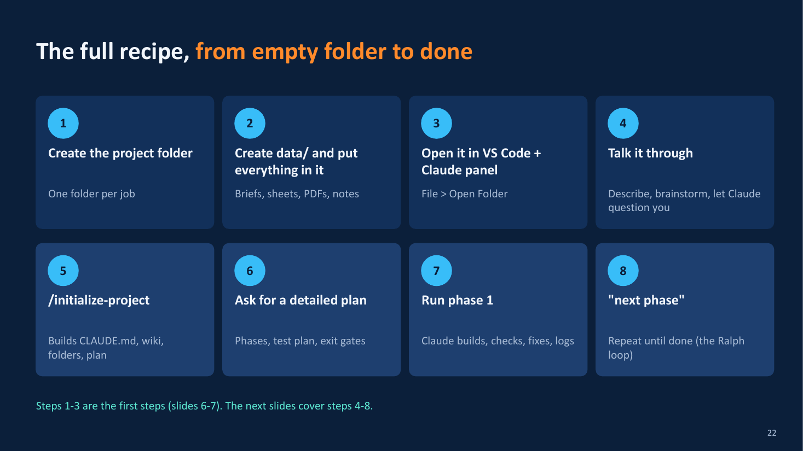
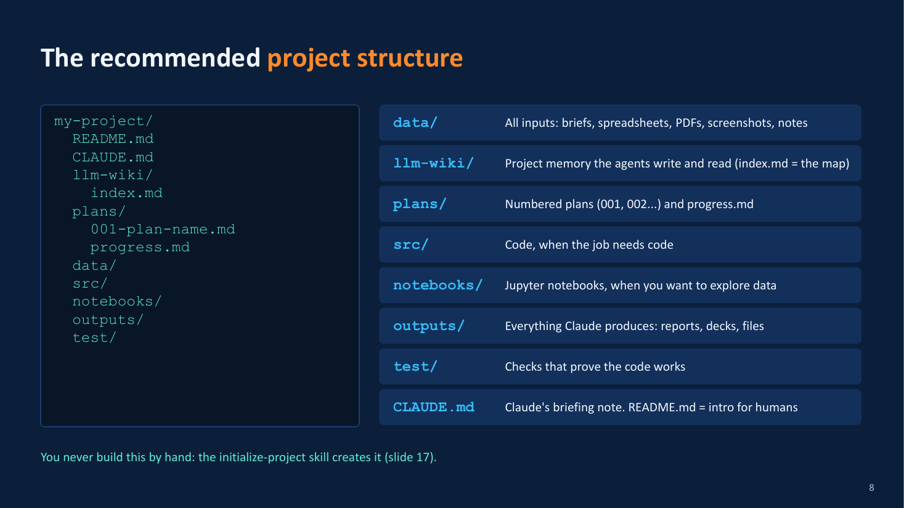
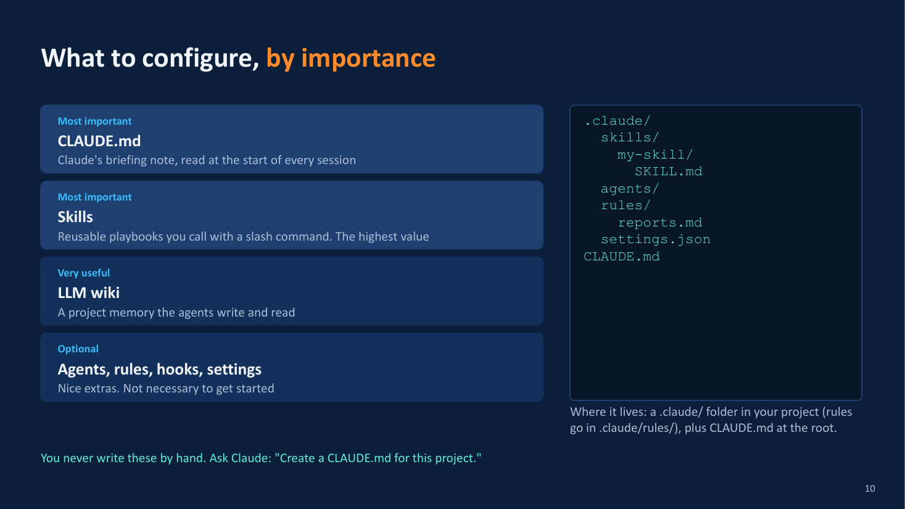
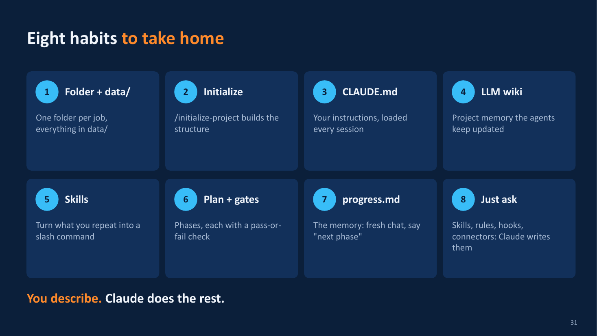

# AI Harness and Claude Code: A Practical Guide

> This is the short version. For the detailed, visual walkthrough, see the beginner slides: [claude_code_vscode_tricks_simplified.pdf](resources/simplified/claude_code_vscode_tricks_simplified.pdf) (editable: [.pptx](resources/simplified/claude_code_vscode_tricks_simplified.pptx)).

## 1. The Evolution of Harness Engineering
Understanding AI agents requires looking at how agent environments have evolved from standard chat interfaces. 

*   **Prompt Engineering (2022)**: Relied entirely on refined system prompts within small 4,000-token context windows. 
*   **Context Engineering Era**: Introduced Tool Calling, the Model Context Protocol (MCP), and Retrieval-Augmented Generation (RAG) to dynamically fetch information into the context window.
*   **The Context Engineering Ceiling**: Relying solely on context management fails during long-horizon tasks (e.g., 12+ hours) because the model repeatedly compresses its own history. This repeated summarization leads to lost details, hallucinated task completion, and unfinished work.
*   **Harness Engineering Era**: Elevates design above pure context management by placing models into structured execution loops. Instead of one continuous, degrading session, the agent operates in an automated loop where every iteration starts with a fresh, clean context window governed by strict entry and exit protocols.

## 2. Core Concepts of an AI Harness
An Agent Harness is the underlying environment and configuration framework (execution loops, tools, context management, and permissions) that turns a standard language model into an autonomous agent capable of executing complex work. 

The core principle of harness engineering is that **when an agent makes a mistake, you must update the harness** (by adding a rule, skill, or hook) rather than just fixing the output. This ensures you never pay for the same mistake twice.

### The 7 Harness Building Blocks
1.  **Rules**: Scoped, always-on instructions. They can be global (loaded every session) or isolated rule files loaded only when the agent touches matching file paths.
2.  **Skills**: Packaged, reusable, and deterministic step-by-step playbooks for predictable workflows (called via slash commands like `/create-ppt-presentation`).
    *   *Global Skills* (`~/.claude/skills/`): Your personal toolbox available across all projects.
    *   *Local Skills* (`my-project/.claude/skills/`): Tied to one specific project, traveling with the repository.
3.  **Sub-agents**: Specialized secondary agents spawned in parallel context windows with dedicated instructions and restricted toolsets (e.g., a reviewer agent).
4.  **Workflows**: Explicit execution sequences linking skills and sub-agents into fixed, repeatable processes.
5.  **Tools**: The actual execution capabilities granted to the agent. Claude comes with built-in tools: *Read, Grep (Search), Glob (Find), Edit, Write, Bash (Run), AskUserQuestion, and Agent (delegate)*. You must set strict boundaries for these tools.
6.  **Connectors (MCP)**: Standardized plugins (Model Context Protocol) connecting the agent to external tools and databases (e.g., Gmail, Google Drive, GitHub, Slack). 
7.  **Hooks**: Programmatic, unbypassable scripts executed automatically at fixed lifecycle events (e.g., a `PreToolUse` hook blocking dangerous shell commands, or a `Stop` hook that notifies you when a task is done).

Global vs local is the split to remember: a global skill (or `CLAUDE.md`) follows you everywhere, a local one travels with the project.



## 3. Common Agent Workflow Patterns
*   **Ralph Loop**: An autonomous, persistent, goal-driven cycle operating without human intervention.
*   **ReAct (Reason + Act)**: The agent reasons about its state, selects/executes a tool, observes feedback, and repeats.
*   **Plan-and-Solve**: Formulates a multi-step sequence, executes steps, and dynamically reassesses.
*   **Orchestrator-Worker**: An orchestrator delegates isolated sub-tasks to specialized worker agents.
*   **Evaluator-Optimizer**: A generator produces output, an evaluator critiques it, looping until refined.
*   **Human-in-the-Loop (HITL)**: Explicit human approval checkpoints are inserted before state-changing actions.

These are consolidated patterns you can customize while still following good practices. You don't have to build them yourself: they are already built into the Claude/Anthropic harness.

[](resources/images/agent-workflow-patterns.png)

---

## 4. How to Start with Claude Code

### 4.1 Easiest way to set up
The fastest start: let Claude replicate the setup shown in the beginner deck for you.

1.  **Open VS Code** and use `File > Open Folder...` to open your project folder (create an empty one if you are starting fresh).

    

2.  **Open the Claude Code panel** by clicking the Claude icon on the side. The window has three areas: project files on the left (blue), your work in the middle (green), Claude chat on the right (red).

    

3.  **Upload the PDF** [claude_code_vscode_tricks_simplified.pdf](resources/simplified/claude_code_vscode_tricks_simplified.pdf) to the Claude Code panel (drag it into the chat or attach it).
4.  **Ask Claude to replicate the setup**, then to tell you what it did and where it created each file. Example prompt:

    ```text
    Read the attached PDF (claude_code_vscode_tricks_simplified). It describes my
    target Claude Code setup for VS Code.

    Replicate that setup for me:
    - Create a global ~/.claude/CLAUDE.md with the habits described (stack, style,
      planning with phases and exit gates, working style).
    - Create the global skills it describes (initialize-project, create-notebook,
      create-ppt-presentation, create-tests, run-tests, etc.) in ~/.claude/skills/.
    - Add the project structure it recommends (data/, llm-wiki/ with index.md,
      plans/ with progress.md, src/, outputs/, test/) with a project CLAUDE.md.
    - Set up the LLM wiki: an llm-wiki/ folder that you (the agent) write and
      maintain, with index.md as the map (repo map of every folder and a list of
      pages) and linked pages like glossary, decisions, open-questions and
      use-cases, using [[wikilinks]]. Add only the pages the project needs.
    - Make CLAUDE.md keep the wiki alive: read llm-wiki/index.md first in every
      session; when you learn or decide something, update the matching page; when
      you add a folder or page, update the repo map in index.md; at the end of a
      session, keep plans/ and progress.md in sync.
    - Set up the Ralph loop as the PDF describes: instructions in my global
      CLAUDE.md (work from plans/ and progress.md, one phase at a time, run the
      exit gate, log evidence in progress.md), plus the skill that creates the
      project structure and a detailed plan with exit gates for each phase.

    Ask me before anything that is unclear. When you are done, list every file you
    created or changed, with its full path and a one-line explanation of what it is for.
    ```

5.  **Review the files** Claude lists, and keep asking it to edit them until they match how you work ("make the style section shorter", "add a rule that...", "change this skill to...").
6.  **Delete what you don't need.** If a skill or rule is not useful for you, remove it (or ask Claude to). A lean setup is better than a big one.

### 4.2 Day-to-day project flow
Once the setup exists, this is the exact 8-step recipe to take a project from an empty folder to a finished result using the Ralph Loop.



**Step 1: Create the project folder**
Create one dedicated folder per job (e.g., `monthly-report/`). Claude will work exclusively inside it.

**Step 2: Create a `data/` folder**
Inside your project folder, create a `data/` directory. Put all inputs here: client briefs, Excel spreadsheets, PDFs, screenshots, and raw notes. 

**Step 3: Open in VS Code**
Go to `File > Open Folder...` and select your project. Click the Claude Code icon on the side panel to open the chat. Claude only sees what is inside this root folder.

**Step 4: Talk it through**
Don't build immediately. Tell Claude: *"Read `data/`. The problem is [X]. Don't plan or build yet. Ask me what is unclear and give me options."* Brainstorm and make your decisions out loud.

**Step 5: Initialize the Project**
Once aligned, type `/initialize-project`. Claude will scaffold the ideal structure: writing your `CLAUDE.md`, creating the `llm-wiki/`, `plans/`, `src/`, `outputs/`, and `test/` folders.

**Step 6: Ask for a detailed plan**
Tell Claude: *"Make a detailed plan in phases, with a test plan and an exit gate for each phase."* Claude will write this to `plans/001-plan-<name>.md`. An exit gate is a mandatory pass-or-fail check (e.g., "Script runs without errors").

**Step 7: Run Phase 1**
Say, *"Do phase 1."* Claude will build the code/content, run the tests (the exit gate), fix its own mistakes, and automatically log the evidence in `plans/progress.md`. 

**Step 8: Say "Next Phase"**
Review the evidence. If it looks good, simply say *"next phase"*. Repeat this loop until the plan is complete. If you get lost, use `/clear` to wipe the chat memory clean: the project state is safely stored in `plans/progress.md` and the `llm-wiki/`.

---

## 5. Folder structure
This is the recommended layout for a project. You never build it by hand: the `initialize-project` skill creates it.



```text
my-project/
  README.md          intro for humans
  CLAUDE.md          Claude's briefing note, loaded every session
  llm-wiki/
    index.md         the map of the project's memory
  plans/
    001-plan-name.md numbered plans (002, 003...)
    progress.md      current step, blockers, exit-gate evidence
  data/              all inputs: briefs, spreadsheets, PDFs, screenshots, notes
  src/               code, when the job needs code
  notebooks/         Jupyter notebooks, when you want to explore data
  outputs/           everything Claude produces: reports, decks, files
  test/              checks that prove the code works
```

Behavior lives in `.claude/` (`settings.json` for permissions and hooks, `rules/`, `skills/`). Add it when you need it, or just ask Claude to create it.



---

## 6. Eight habits to take home


